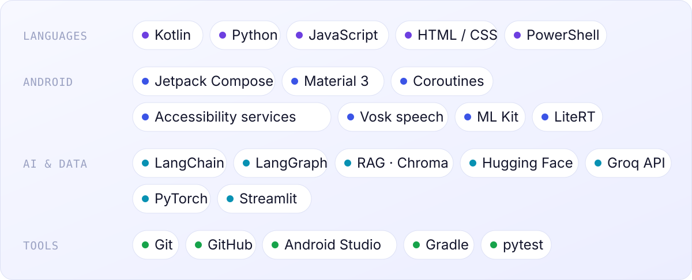
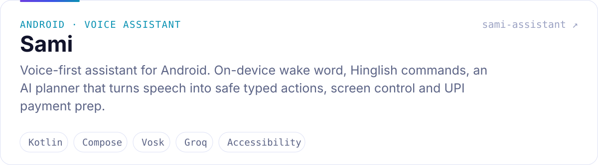
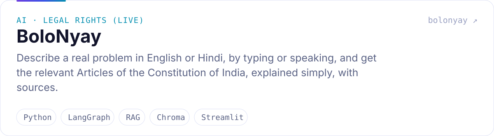
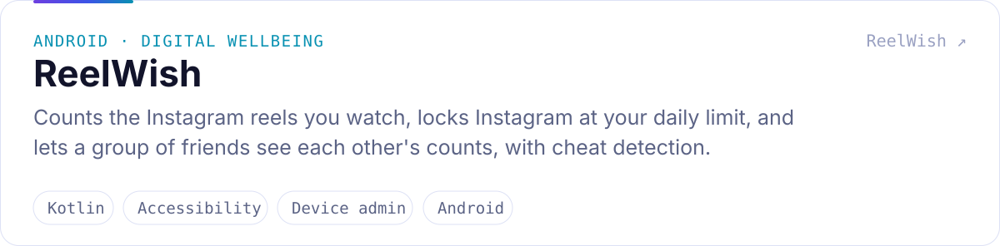
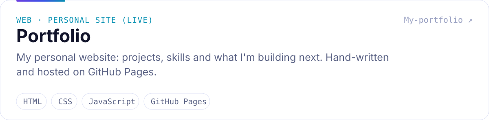
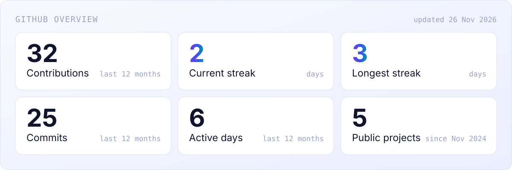
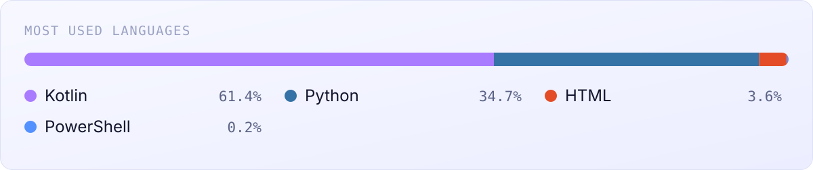
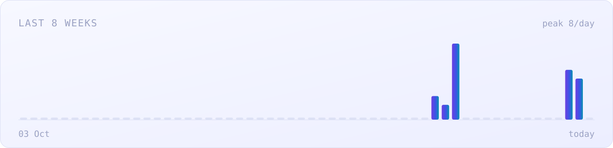

<a href="https://github.com/Codebro786">
  <picture>
    <source media="(prefers-color-scheme: dark)" srcset="assets/hero-dark.svg">
    
  </picture>
</a>

### About me

I'm **Samit**, a Computer Science student who builds Android apps that solve problems I actually have.
It started with wanting an assistant that understands how I really talk, in Hinglish, and turned into
**Sami**, a voice assistant with its own wake word, screen control and an AI planner. Along the way I built
**BoloNyay**, which explains people's constitutional rights in plain English or Hindi, and **ReelWish**,
which keeps my friends and me off endless reels.

I like Kotlin, Jetpack Compose and digging into Android's system services, and I'm learning how to make
AI features that are useful and safe on a phone.

<picture>
  <source media="(prefers-color-scheme: dark)" srcset="assets/divider-dark.svg">
  
</picture>

### Tech stack

<picture>
  <source media="(prefers-color-scheme: dark)" srcset="assets/tech-dark.svg">
  
</picture>

### Featured projects

  <a href="https://github.com/Codebro786/sami-assistant"><picture><source media="(prefers-color-scheme: dark)" srcset="assets/project-sami-dark.svg"></picture></a>
  <a href="https://github.com/Codebro786/bolonyay"><picture><source media="(prefers-color-scheme: dark)" srcset="assets/project-bolonyay-dark.svg"></picture></a>
  <a href="https://github.com/Codebro786/ReelWish"><picture><source media="(prefers-color-scheme: dark)" srcset="assets/project-reelwish-dark.svg"></picture></a>
  <a href="https://github.com/Codebro786/My-portfolio"><picture><source media="(prefers-color-scheme: dark)" srcset="assets/project-portfolio-dark.svg"></picture></a>

  
  

<picture>
  <source media="(prefers-color-scheme: dark)" srcset="assets/divider-dark.svg">
  
</picture>

### GitHub activity

<picture>
  <source media="(prefers-color-scheme: dark)" srcset="assets/generated/overview-dark.svg">
  
</picture>

  <picture><source media="(prefers-color-scheme: dark)" srcset="assets/generated/languages-dark.svg"></picture>
  <picture><source media="(prefers-color-scheme: dark)" srcset="assets/generated/activity-dark.svg"></picture>

<picture>
  <source media="(prefers-color-scheme: dark)" srcset="https://raw.githubusercontent.com/Codebro786/Codebro786/output/snake-dark.svg">
  
</picture>

<picture>
  <source media="(prefers-color-scheme: dark)" srcset="assets/footer-dark.svg">
  
</picture>

Stats and the snake are regenerated daily by a GitHub Action in this repo.
